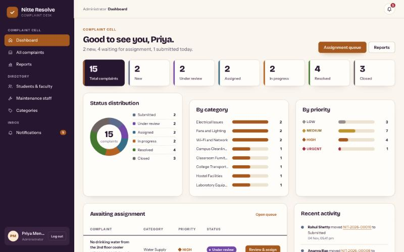
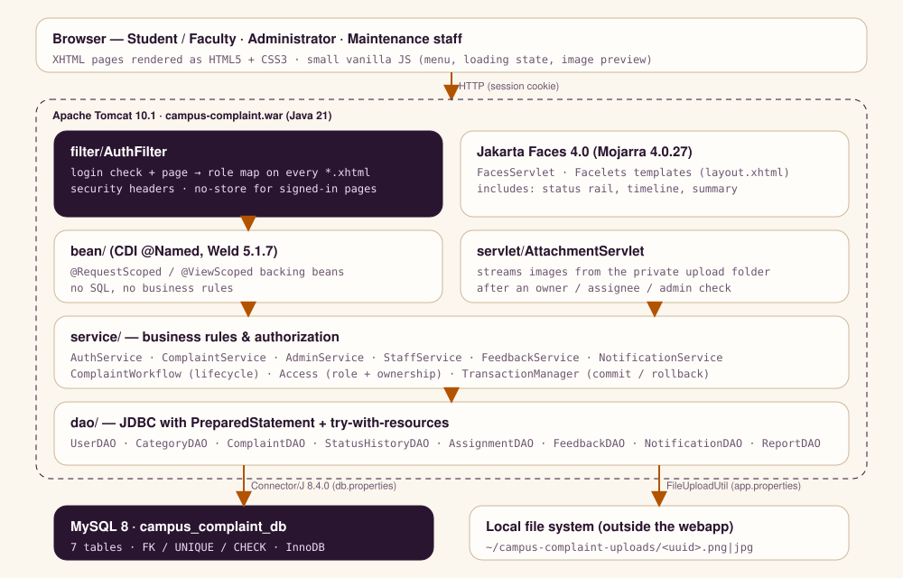
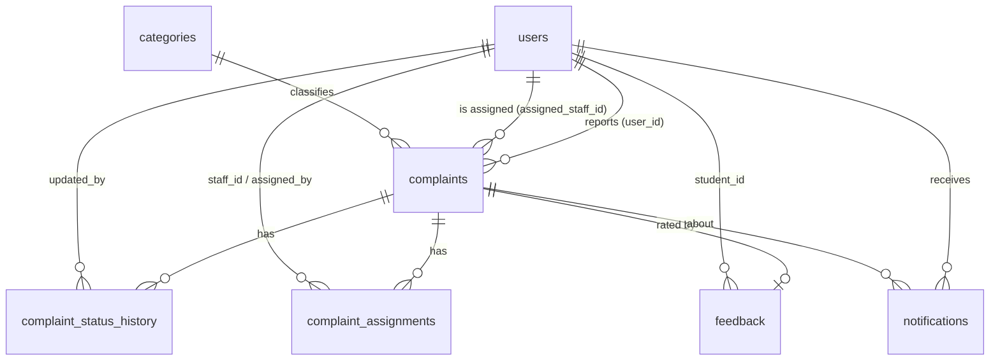
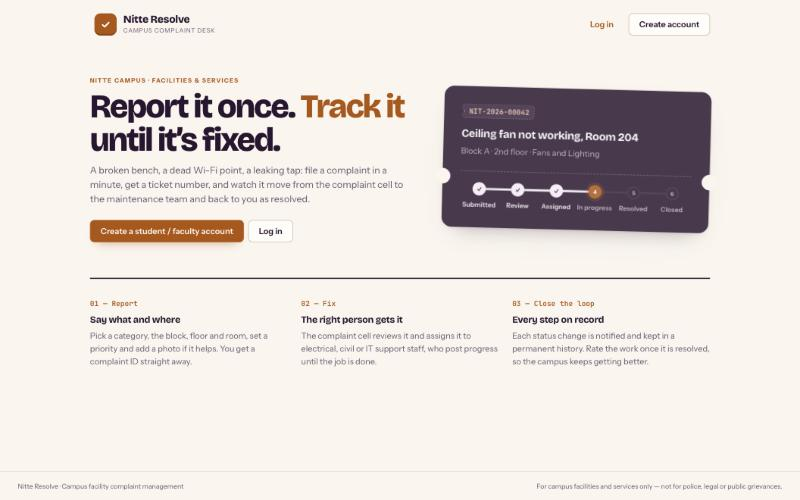
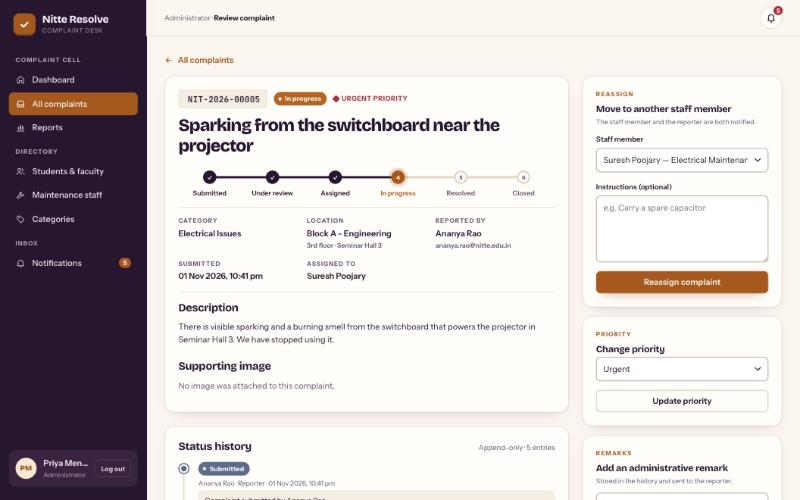
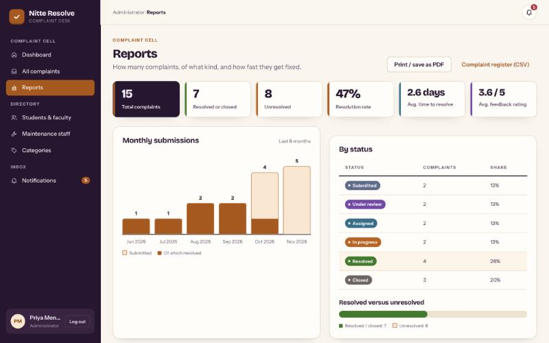
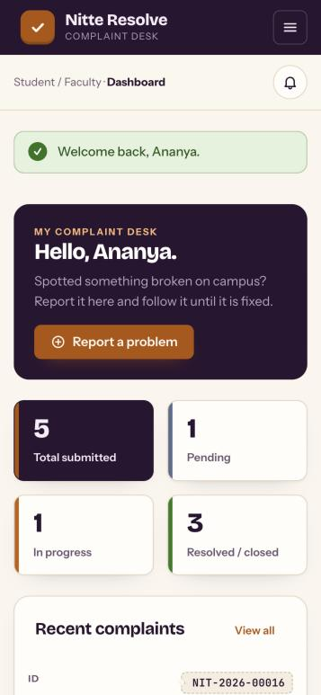
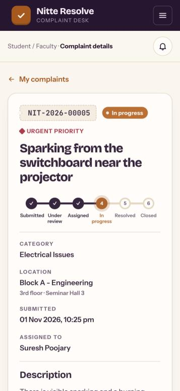
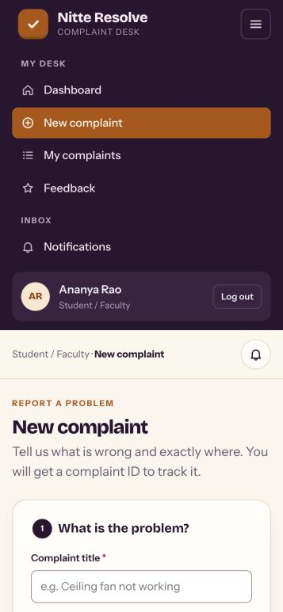

# Nitte Resolve — College Campus Complaint Management System

<p align="center">
  
  
  
  
  
  
  
  
</p>

---

A centralized complaint desk for **campus facilities and services**. Students and
faculty report problems (a broken fan, a dead Wi-Fi point, a leaking tap), the
complaint cell reviews and assigns them, maintenance staff fix them, and every
step is notified and kept in a permanent history.

> Scope: campus facility and service complaints only. It is not a police,
> legal or public-grievance platform.

The application is built on Jakarta Faces 4 + CDI + plain JDBC on Tomcat 10.1,
packaged as a Maven WAR — a layered (model / DAO / service / bean) Java web
application without Spring or any JavaScript framework.

**Live demo:** https://campus-complaint-management.up.railway.app — log in with any
of the [demo accounts](#demo-credentials), e.g. `admin@nitte.edu.in` /
`Admin@123`. (Hosted on Railway; the demo data is shared by everyone who
visits.)



---

## Contents

1. [Features](#features)
2. [Technology stack](#technology-stack)
3. [Architecture](#architecture)
4. [Project structure](#project-structure)
5. [Database schema](#database-schema)
6. [Setup: MySQL](#setup-mysql)
7. [Configuration](#configuration)
8. [Build](#build)
9. [Deploy on Tomcat 10.1](#deploy-on-tomcat-101)
    - [Deploy on Railway](#deploy-on-railway)
10. [Import into Eclipse](#import-into-eclipse)
11. [Run locally on Windows (step by step)](#run-locally-on-windows-step-by-step)
12. [Get the code from / push it to GitHub](#get-the-code-from--push-it-to-github)
13. [Demo credentials](#demo-credentials)
14. [Testing](#testing)
15. [Security](#security)
16. [Troubleshooting](#troubleshooting)
17. [Screenshots](#screenshots)
18. [Known limitations](#known-limitations)

---

## Features

### Student / faculty (role `STUDENT`)
- Self-registration and login (always a reporter account — never staff or admin).
- Submit a complaint: title, category, description, campus block, floor,
  room/location, priority (Low / Medium / High) and an optional JPG/PNG image.
- Receives a unique, human-readable complaint ID, e.g. `NIT-2026-00016`.
- **My complaints**: search by ID or title, filter by status and category.
- Complaint details with a six-step **status rail**, the full status history
  and every remark from the complaint cell and the technician.
- In-app notifications at every status change, remark and assignment.
- Feedback (1–5 stars + comment) once a complaint is resolved — once per complaint.
- Dashboard: totals, pending, in progress, resolved, recent complaints, recent
  notifications, quick "Report a problem" action.

### Administrator (role `ADMIN`, the complaint cell)
- Dashboard: total / new / under review / assigned / in progress / resolved /
  closed counters, status donut, category and priority bars (pure CSS, no chart
  library), recent submissions, assignment queue, recent activity feed.
- **All complaints**: search by ID, title or reporter; filter by status,
  category, priority, assigned staff, submission date range, unassigned only;
  **CSV export** of the filtered list.
- **Complaint review** workbench: view everything including the evidence image,
  mark under review, assign / reassign to maintenance staff with instructions,
  change priority (including Urgent), add administrative remarks, close a
  resolved complaint or reopen it with a reason.
- Manage student/faculty accounts and maintenance staff accounts: add, edit,
  activate/deactivate, reset password, delete (only when no complaint history).
- Manage complaint categories: add, edit, hide/show, delete unused.
- **Reports**: totals, resolution rate, average time to resolve, average rating,
  monthly submissions (6 months), complaints by category / status / priority,
  resolved vs. unresolved, staff assignment statistics, all reporter feedback.
  Printable (print stylesheet) and exportable (CSV).

### Maintenance / support staff (role `STAFF`)
- Dashboard: total assigned, new assignments, in progress, resolved; work-order
  cards (most urgent first) and a task table.
- Assigned complaints with status and priority filters; completed-work view.
- Work order page: details, location, image, history; **Start work**
  (→ In progress), **Post update** (remark, status unchanged), **Mark resolved**
  (requires a description of the work done). Sees the reporter's rating.
- Can only see and change complaints currently assigned to them.

### Status lifecycle

```
SUBMITTED → UNDER_REVIEW → ASSIGNED → IN_PROGRESS → RESOLVED → CLOSED
```

| Move | Who | Notes |
|---|---|---|
| — → SUBMITTED | reporter | on submission |
| SUBMITTED → UNDER_REVIEW | admin | explicit, or automatically when a SUBMITTED complaint is assigned |
| SUBMITTED / UNDER_REVIEW / ASSIGNED / IN_PROGRESS → ASSIGNED | admin | assign or reassign; writes `complaint_assignments` |
| ASSIGNED → IN_PROGRESS | assigned staff | |
| IN_PROGRESS → RESOLVED | assigned staff | description of the work required; sets `resolved_at` |
| RESOLVED → CLOSED | admin | sets `closed_at` |
| RESOLVED → ASSIGNED | admin | reopen; reason required |

Every move and every remark appends a row to `complaint_status_history`
(previous status, new status, who, remarks, timestamp). The application never
updates or deletes a history row. All rules live in
[`ComplaintWorkflow`](src/main/java/com/campuscomplaint/service/ComplaintWorkflow.java).

---

## Technology stack

No Spring, Hibernate/JPA or JavaScript framework.

| Layer | Technology |
|---|---|
| Language | Java 21 |
| Web framework | Jakarta Faces 4.0 — Mojarra 4.0.27 (XHTML / Facelets) |
| Dependency injection | CDI 4.0.1 — Weld Servlet 5.1.7.Final |
| Server | Apache Tomcat 10.1 (Servlet 6.0) |
| Database | MySQL 8, plain JDBC, MySQL Connector/J 8.4.0 |
| Build | Maven 3.8+, WAR packaging |
| Front end | HTML5, CSS3, a few lines of vanilla JavaScript |

---

## Architecture



Layers:

| Layer | Package | Responsibility |
|---|---|---|
| Filter | `filter` | `AuthFilter` — login check and page → role map for every `*.xhtml`; security headers |
| View | `src/main/webapp` | XHTML pages on two Facelets templates (`layout.xhtml` for signed-in pages, `public.xhtml`), shared includes |
| Backing beans | `bean` | CDI `@Named` beans (`@RequestScoped` / `@ViewScoped`); read the session user, call services, show messages. **No SQL, no business rules.** |
| Services | `service` | Validation, lifecycle rules, **role and ownership checks inside every method**, transactions |
| DAO | `dao` | All SQL. `PreparedStatement` for every query, try-with-resources for every connection/statement/result set |
| Model | `model` | Plain serializable data classes |
| Utilities | `util` | `DBConnection`, `PasswordUtil` (PBKDF2), `SessionUtil`, `FacesUtil`, `FileUploadUtil`, `TransactionManager`, `InputValidator`, exceptions |
| Servlet | `servlet` | `AttachmentServlet` streams complaint images after a permission check |

Multi-row changes (submission, assignment, status change + history +
notifications, feedback) run in one database transaction through
`TransactionManager.inTransaction(...)`; the complaint row is locked with
`SELECT … FOR UPDATE` and status updates are guarded with
`WHERE status = <expected>`, so concurrent edits cannot skip or repeat a step.

---

## Project structure

```
College Campus Complaint Management System/
├── pom.xml
├── Dockerfile                      container build used by the Railway deployment
├── README.md
├── docs/
│   ├── architecture-diagram.svg
│   ├── schema-diagram.svg
│   └── screenshots/
├── tests/e2e/                      end-to-end test suite (Python, no dependencies)
│   ├── jsf.py
│   └── test_e2e.py
└── src/main/
    ├── java/com/campuscomplaint/
    │   ├── bean/      LoginBean, RegisterBean, StudentDashboardBean, ComplaintBean,
    │   │              MyComplaintsBean, ComplaintDetailsBean, FeedbackBean, NotificationBean,
    │   │              AdminDashboardBean, AdminComplaintBean, ComplaintReviewBean, AccountBean,
    │   │              CategoryBean, ReportBean, StaffDashboardBean, AssignedComplaintsBean,
    │   │              StaffComplaintBean, LookupBean
    │   ├── dao/       UserDAO, CategoryDAO, ComplaintDAO, StatusHistoryDAO, AssignmentDAO,
    │   │              FeedbackDAO, NotificationDAO, ReportDAO, DaoSupport
    │   ├── filter/    AuthFilter
    │   ├── model/     User, Category, Complaint, ComplaintStatusHistory, ComplaintAssignment,
    │   │              Feedback, Notification, ComplaintFilter, StatusSummary, StatCount, StaffStat
    │   ├── service/   AuthService, ComplaintService, AdminService, StaffService, FeedbackService,
    │   │              NotificationService, ComplaintWorkflow, Access
    │   ├── servlet/   AttachmentServlet
    │   └── util/      DBConnection, PasswordUtil, SessionUtil, FacesUtil, FileUploadUtil,
    │                  TransactionManager, InputValidator, AppConfig, DataAccessException,
    │                  ValidationException, TestConnection
    ├── resources/
    │   ├── db.properties           database settings (overridden by DB_URL / DB_USER / DB_PASSWORD)
    │   ├── app.properties          upload folder, size limit, complaint code prefix
    │   ├── schema.sql              non-destructive schema (IF NOT EXISTS)
    │   ├── sample-data.sql         idempotent demo data (INSERT IGNORE)
    │   └── reset-database.sql      DESTRUCTIVE: drops the database (development only)
    └── webapp/
        ├── index.xhtml  login.xhtml  register.xhtml  error.xhtml
        ├── student-dashboard.xhtml  submit-complaint.xhtml  my-complaints.xhtml
        ├── complaint-details.xhtml  feedback.xhtml  notifications.xhtml
        ├── admin-dashboard.xhtml  admin-complaints.xhtml  complaint-review.xhtml
        ├── manage-users.xhtml  manage-staff.xhtml  manage-categories.xhtml  reports.xhtml
        ├── staff-dashboard.xhtml  assigned-complaints.xhtml  staff-complaint-details.xhtml
        ├── resources/css/style.css  resources/js/app.js  resources/img/favicon.svg
        └── WEB-INF/
            ├── web.xml  beans.xml  faces-config.xml
            ├── templates/  layout.xhtml  public.xhtml
            └── includes/   icons, status-rail, timeline, complaint-summary, accounts, empty
```

---

## Database schema

Database `campus_complaint_db` (utf8mb4, InnoDB). Diagram:
[`docs/schema-diagram.svg`](docs/schema-diagram.svg).



| Table | Purpose | Key constraints |
|---|---|---|
| `users` | everyone who logs in; `role` ∈ STUDENT, ADMIN, STAFF; `is_active` | `UNIQUE(email)`, index on `(role, is_active)` |
| `categories` | complaint categories; `is_active` hides retired ones from the form | `UNIQUE(name)` |
| `complaints` | one row per complaint, **current** status only | `UNIQUE(complaint_code)`; FKs to users (reporter, `ON DELETE RESTRICT`), categories (`RESTRICT`), assigned staff (`SET NULL`); indexes on status, reporter, staff+status, category, priority, created_at |
| `complaint_status_history` | append-only audit trail (previous → new, by, remarks, time) | FK complaint (`CASCADE`), FK updated_by; index `(complaint_id, created_at)` |
| `complaint_assignments` | every (re)assignment, by whom, with a note | FKs to complaint, staff, admin |
| `feedback` | one rating per complaint | `UNIQUE(complaint_id)`, `CHECK (rating BETWEEN 1 AND 5)` |
| `notifications` | in-app notifications | FK user (`CASCADE`), FK complaint; index `(user_id, is_read, created_at)` |

Two columns beyond the brief: `users.department` (branch for students, trade
for staff — shown in assignment lists) and `users.is_active` (deactivate an
account without losing its history).

**Complaint codes** — `NIT-<year>-<id padded to 5 digits>`. The row is
inserted with a unique temporary code, then given its final code from the
generated id in the same transaction, so codes are unique by construction and
also protected by `UNIQUE(complaint_code)`. The prefix is configurable.

---

## Setup: MySQL

Requires MySQL 8 (or newer) running locally.

```bash
mysql -u root -p < src/main/resources/schema.sql
```

```bash
mysql -u root -p < src/main/resources/sample-data.sql
```

Both scripts are safe to run more than once: `schema.sql` only uses
`CREATE … IF NOT EXISTS`, and `sample-data.sql` inserts fixed ids with
`INSERT IGNORE`. Sample dates are relative to `NOW()`, so the dashboards
always look current.

To start over with a clean demo (destructive — deletes the database):

```bash
mysql -u root -p < src/main/resources/reset-database.sql
```

then run `schema.sql` and `sample-data.sql` again.

The sample data contains 1 administrator, 3 students + 1 faculty member,
3 maintenance staff, 12 categories, 15 complaints covering every status,
11 assignments, 60 history rows, 5 feedback entries and 91 notifications.

---

## Configuration

### `src/main/resources/db.properties`

The only place database credentials live:

```properties
db.driver=com.mysql.cj.jdbc.Driver
db.url=jdbc:mysql://localhost:3306/campus_complaint_db?sslMode=DISABLED&allowPublicKeyRetrieval=true&serverTimezone=Asia/Kolkata
db.user=root
db.password=
```

Set `db.password` if your MySQL root account has one, then rebuild.

### `src/main/resources/app.properties`

| Key | Default | Meaning |
|---|---|---|
| `upload.directory` | *(empty)* → `~/campus-complaint-uploads` | private image folder **outside** the web application |
| `upload.maxBytes` | `5242880` | largest accepted image (5 MB) |
| `complaint.codePrefix` | `NIT` | prefix of complaint IDs |

The Tomcat user must be able to write to the upload folder; it is created on
the first upload.

Check the database configuration without Tomcat: run
`com.campuscomplaint.util.TestConnection` (Eclipse: *Run As → Java
Application*). It prints the MySQL version and the row count of every table.

---

## Build

Use a Java 21 JDK:

```bash
mvn clean package
```

The result is `target/campus-complaint.war` (~10 MB; Mojarra, Weld and
Connector/J are inside `WEB-INF/lib`). On macOS with several JDKs, point
Maven at 21 explicitly:

```bash
JAVA_HOME=$(/usr/libexec/java_home -v 21) mvn clean package
```

---

## Deploy on Tomcat 10.1

Tomcat 10.1 is required (Jakarta EE 10 / Servlet 6.0). Tomcat 9 will not work.

1. Build the WAR (see above).
2. Copy it into Tomcat's `webapps` folder:

   ```bash
   cp target/campus-complaint.war $CATALINA_HOME/webapps/
   ```

   Homebrew on macOS: `$CATALINA_HOME` is `/opt/homebrew/opt/tomcat@10/libexec`.
3. Start Tomcat with Java 21:

   ```bash
   $CATALINA_HOME/bin/catalina.sh run
   ```

4. Open **http://localhost:8080/campus-complaint/**

Or use the Tomcat Manager app (*WAR file to deploy*). To redeploy, copy the new
WAR over the old one; Tomcat reloads it automatically (signed-in users have to
log in again).

Verified: the WAR deploys on Apache Tomcat **10.1.61** with OpenJDK **21**
without errors or warnings in the Tomcat logs.

### Deploy on Railway

The live demo runs on [Railway](https://railway.com) from the `Dockerfile` in
this repository: Maven builds the WAR with Java 21, and Tomcat 10.1 serves it
as the root application on the port Railway assigns.

**Settings come from environment variables** (they override `db.properties` /
`app.properties`, so no password is ever committed):

| Variable | Value on Railway |
|---|---|
| `DB_URL` | `jdbc:mysql://${{MySQL.MYSQLHOST}}:${{MySQL.MYSQLPORT}}/campus_complaint_db?sslMode=DISABLED&allowPublicKeyRetrieval=true&connectionTimeZone=UTC` |
| `DB_USER` | `${{MySQL.MYSQLUSER}}` |
| `DB_PASSWORD` | `${{MySQL.MYSQLPASSWORD}}` |
| `UPLOAD_DIRECTORY` | `/data/uploads` (a Railway volume is mounted at `/data`) |
| `TZ` | `Asia/Kolkata` |

`connectionTimeZone=UTC` matters: Railway's MySQL runs in UTC, while the app
shows times in India time.

**Set it up from scratch** with the [Railway CLI](https://docs.railway.com/guides/cli)
(`brew install railway`, or `npm i -g @railway/cli` on Windows), from the
project folder:

1. `railway login`, then `railway init --name campus-complaint-management`.
2. `railway add --database mysql` — adds a MySQL service with its own volume.
3. Load `schema.sql` and `sample-data.sql` into it. Either run
   `railway connect MySQL` (needs an SSH key in `~/.ssh`) and paste the two
   files, or deploy a throw-away service from a `mysql:8.4` image that runs
   both scripts against `${{MySQL.MYSQLHOST}}` and then delete it.
4. `railway add --service web` with the five variables above.
5. `railway service link web`, then `railway volume add --mount-path /data`.
6. `railway up --service web --detach` — uploads the folder and builds the Dockerfile.
7. `railway domain --service web` — creates the public `*.up.railway.app` address.
   Rename it with `railway domain update <current-domain> --domain campus-complaint-management --service web`.

**Redeploy after a code change:** `railway up --service web --detach`.
Logs: `railway service logs --service web`.

---

## Import into Eclipse

1. *File → Import → Maven → Existing Maven Projects*, choose this folder.
2. Make sure the project uses a Java 21 JRE (*Properties → Java Build Path*)
   and compiler compliance 21.
3. Add Tomcat 10.1 in the *Servers* view (*New → Server → Apache → Tomcat v10.1*).
4. Right-click the project → *Run As → Run on Server* → Tomcat 10.1.
5. Optional: run `util/TestConnection.java` as a Java application to check
   the database settings first.

Eclipse uses the Maven dependencies from `pom.xml`; nothing has to be added to
Tomcat's own `lib` folder.

---

## Run locally on Windows (step by step)

Tested layout: Windows 10/11, commands typed in **Command Prompt** (`cmd`).
PowerShell notes are given where a command differs.

### 1. Install the tools (once)

| Tool | Download | Install notes |
|---|---|---|
| **JDK 21** | [Eclipse Temurin 21 (MSI)](https://adoptium.net/temurin/releases/?version=21&os=windows) | In the installer enable **"Set JAVA_HOME variable"** and **"Add to PATH"**. |
| **Maven 3.9** | [maven.apache.org/download.cgi](https://maven.apache.org/download.cgi) → *Binary zip archive* | Unzip to `C:\tools\apache-maven-3.9.x` and add `C:\tools\apache-maven-3.9.x\bin` to **Path** (see below). |
| **MySQL 8** | [MySQL Installer for Windows](https://dev.mysql.com/downloads/installer/) | Choose *Server only* (or *Developer Default*). Remember the **root password** you set. Keep port 3306. |
| **Tomcat 10.1** | [tomcat.apache.org/download-10.cgi](https://tomcat.apache.org/download-10.cgi) → *64-bit Windows zip* | Unzip to `C:\tools\apache-tomcat-10.1.x`. (Not Tomcat 9 or 11.) |
| **Git** (optional) | [git-scm.com/download/win](https://git-scm.com/download/win) | Default options are fine. |

**Adding a folder to Path:** Start → search *"Edit the system environment
variables"* → *Environment Variables…* → under *System variables* select
**Path** → *Edit* → *New* → paste the folder → OK on every window. Also add
`C:\Program Files\MySQL\MySQL Server 8.0\bin` so the `mysql` command works.
Then **open a new Command Prompt** (old windows don't see the change).

Check everything in the new window:

```bat
java -version
```

```bat
mvn -v
```

```bat
mysql --version
```

`java -version` and the "Java version" line of `mvn -v` must both say **21**.
If `mvn -v` shows another Java, set `JAVA_HOME` to the JDK 21 folder (e.g.
`C:\Program Files\Eclipse Adoptium\jdk-21.x.x-hotspot`) in the same
*Environment Variables* dialog.

### 2. Get the project

Either download it from GitHub (*Code → Download ZIP*, then unzip) or clone it:

```bat
cd %USERPROFILE%\Documents
```

```bat
git clone https://github.com/Dhanya-J-Poojary/Campus-Complaint-Management-System.git
```

```bat
cd Campus-Complaint-Management-System
```

All following commands are run **inside the project folder**. If the folder
name contains spaces, wrap paths in quotes, e.g. `cd "C:\My Projects\Campus"`.

### 3. Create the database

```bat
mysql -u root -p -e "source src/main/resources/schema.sql"
```

```bat
mysql -u root -p -e "source src/main/resources/sample-data.sql"
```

Enter your MySQL root password when asked. (`source` works in both cmd and
PowerShell; PowerShell does not support the `< file.sql` redirection.)

Check it worked:

```bat
mysql -u root -p -e "SELECT COUNT(*) FROM campus_complaint_db.complaints"
```

It should print `15`.

### 4. Put your MySQL password in `db.properties`

Open `src\main\resources\db.properties` in Notepad / VS Code and set the
password you chose in the MySQL installer:

```properties
db.password=YourRootPassword
```

(Leave `db.url` and `db.user` as they are.) Image uploads go to
`%USERPROFILE%\campus-complaint-uploads` automatically; to use another folder
set `upload.directory=C:/campus-uploads` in `src\main\resources\app.properties`
(forward slashes work fine on Windows).

### 5. Build the WAR

```bat
mvn clean package
```

The first build downloads the dependencies (a few minutes). It must end with
`BUILD SUCCESS` and produce `target\campus-complaint.war`.

### 6. Deploy and start Tomcat

```bat
copy target\campus-complaint.war C:\tools\apache-tomcat-10.1.x\webapps\
```

```bat
C:\tools\apache-tomcat-10.1.x\bin\catalina.bat run
```

Replace `10.1.x` with your real folder name. `catalina.bat run` keeps Tomcat
in this window and shows the log; wait for `Server startup in [...]
milliseconds`. (Alternatively `startup.bat` opens Tomcat in its own window.)

### 7. Open the app

Browse to **http://localhost:8080/campus-complaint/** and log in with one of
the [demo accounts](#demo-credentials), e.g. `admin@nitte.edu.in` /
`Admin@123`.

To stop Tomcat press **Ctrl + C** in its window (or run `shutdown.bat`).

### Re-deploying after a code change

```bat
mvn clean package
```

```bat
copy /Y target\campus-complaint.war C:\tools\apache-tomcat-10.1.x\webapps\
```

Tomcat picks up the new WAR within a few seconds; log in again.

### Windows-specific problems

| Problem | Fix |
|---|---|
| `'mvn' / 'mysql' is not recognized…` | The `bin` folder is not on **Path**, or the Command Prompt was opened before you changed it. Fix Path and open a new window. |
| `JAVA_HOME is not defined correctly` | Set `JAVA_HOME` to the JDK 21 folder (without `\bin`) and open a new window. |
| `Access denied for user 'root'@'localhost'` | Wrong/missing `db.password` in `db.properties`; fix it and rebuild (step 5). |
| `Address already in use: bind` / port 8080 busy | Another program uses 8080. Edit `conf\server.xml` in Tomcat, change `port="8080"` to `8081`, and use `http://localhost:8081/campus-complaint/`. |
| Tomcat window closes immediately with `startup.bat` | Use `catalina.bat run` to see the error message (usually `JAVA_HOME`). |
| MySQL service not running | Win + R → `services.msc` → start **MySQL80**. |
| Windows Firewall prompt for Java | Allow on *Private networks*; the app only needs localhost. |
| Run the end-to-end tests | Install [Python 3](https://www.python.org/downloads/windows/), then `py tests\e2e\test_e2e.py` (the `mysql` client must be on Path and root must have no password, or adjust `sql()` in the script). |

### Using Eclipse on Windows instead

Install *Eclipse IDE for Enterprise Java and Web Developers*, then follow
[Import into Eclipse](#import-into-eclipse) and point the Tomcat v10.1 server
at `C:\tools\apache-tomcat-10.1.x`. Steps 3 and 4 above (database and
`db.properties`) are still required.

---

## Get the code from / push it to GitHub

Repository: **https://github.com/Dhanya-J-Poojary/Campus-Complaint-Management-System**

### Clone it on another machine

```bash
git clone https://github.com/Dhanya-J-Poojary/Campus-Complaint-Management-System.git
```

### Push your changes

From the project folder (Windows cmd, macOS or Linux — same commands):

```bash
git add .
```

```bash
git commit -m "Describe what you changed"
```

```bash
git push
```

The first push from a new computer asks you to sign in to GitHub (a browser
window opens with Git Credential Manager on Windows).

### Publishing a fresh copy of the folder (first time only)

If you start from a copy of the folder that is not yet a Git repository:

```bash
git init -b main
```

```bash
git add .
```

```bash
git commit -m "Initial commit"
```

```bash
git remote add origin https://github.com/Dhanya-J-Poojary/Campus-Complaint-Management-System.git
```

```bash
git push -u origin main
```

`.gitignore` keeps `target/`, IDE files and `.DS_Store` out of the repository.
Before pushing, make sure `db.properties` does **not** contain your real MySQL
password — keep `db.password=` empty in the committed file and set it only on
your own machine.

---

## Demo credentials

All passwords are stored as individually salted PBKDF2 hashes.

| Role | E-mail | Password |
|---|---|---|
| Administrator | `admin@nitte.edu.in` | `Admin@123` |
| Student | `ananya.rao@nitte.edu.in` | `Student@123` |
| Student | `rahul.shetty@nitte.edu.in` | `Student@123` |
| Student | `fathima.zahra@nitte.edu.in` | `Student@123` |
| Faculty (reporter) | `kiran.hegde@nitte.edu.in` | `Student@123` |
| Maintenance — electrical | `suresh.poojary@nitte.edu.in` | `Staff@123` |
| Maintenance — civil & plumbing | `mohan.kumar@nitte.edu.in` | `Staff@123` |
| Maintenance — IT & network | `deepa.nayak@nitte.edu.in` | `Staff@123` |

Administrators cannot be created from the web pages. To add another, insert a
row with `role = 'ADMIN'` and a hash produced by
`java -cp target/classes com.campuscomplaint.util.PasswordUtil <password>`.

### Walk through the main workflow

1. Log in as **ananya.rao** → *New complaint* → fill in the form, attach a
   photo → you get e.g. `NIT-2026-00016`.
2. Log in as **admin** → *Dashboard → Assignment queue* → *Review & assign* →
   assign to Suresh Poojary.
3. Log in as **suresh.poojary** → open the work order → *Start work* →
   *Post update* → *Mark resolved*.
4. Log in as **ananya.rao** → the notifications and the full history are there
   → *Give feedback*.
5. Log in as **admin** → *Close complaint*.

---

## Testing

`tests/e2e/test_e2e.py` drives the deployed application over HTTP like a
browser (real JSF form posts with ViewState, multipart uploads, cookies) and
checks every result in MySQL. It needs only Python 3 and the `mysql` client.

```bash
python3 tests/e2e/test_e2e.py
```

(Set `CC_BASE_URL` if the app is not at `http://localhost:8080/campus-complaint`.)
The run creates one complaint; reset the demo data afterwards.

Last run: **107 / 107 checks passed** against the WAR on Tomcat 10.1.61,
covering all scenarios of the brief:

| # | Scenario | Checked |
|---|---|---|
| 1 | Student registration and login | weak password, duplicate e-mail and mismatched passwords refused; account stored as STUDENT with a PBKDF2 hash; new account logs in |
| 2 | Administrator login | lands on the admin dashboard |
| 3 | Maintenance staff login | lands on the staff dashboard |
| 4 | Complaint submission | stored as SUBMITTED with a UUID image name; redirected and highlighted |
| 5 | Unique complaint ID | `NIT-<year>-<5 digits>` derived from the id; no duplicates |
| 6 | Complaint listing | list, details, status rail, history |
| 7 | Complaint assignment | status, assignment row, notifications; duplicate assignment refused |
| 8 | Status updates | priority change, start work, progress remark, resolve, close |
| 9 | Status history | NULL→SUBMITTED, auto UNDER_REVIEW, full lifecycle, remark rows |
| 10 | Staff authorization | admin pages blocked; another staff member can't open or list the work order |
| 11 | Student privacy | other student can't open the complaint, list it or load its image |
| 12 | Feedback | rating required, stored once, not offered twice, not available to others |
| 13 | Notifications | on submission, assignment, every status change, feedback; mark all read |
| 14 | Search and filtering | by ID, status, reporter + priority, staff, dates (future date refused), dashboard links; `%` is escaped |
| 15 | Invalid form submissions | empty form, too-short fields, tampered URGENT priority, resolve without description |
| 16 | Unauthorized page access | anonymous → login; wrong role → own dashboard with a message |
| 17 | File upload validation | fake PNG, `.exe`, > 5 MB, extension/content mismatch refused; nothing stored; access control on images |
| 18 | Database connectivity | sample data reachable |

Plus: every page renders for its role without errors, CSV export, category
management, logout invalidates the session. The responsive layout was checked
at 1440 px and 375 px (no horizontal scrolling, mobile navigation works).

---

## Security

| Requirement | Implementation |
|---|---|
| Password storage | PBKDF2-HMAC-SHA256, 210,000 iterations, 16-byte random salt per user, constant-time comparison (`PasswordUtil`) |
| Login | uniform error message; dummy hash check for unknown e-mails (no timing oracle); deactivated accounts refused; session id changed at login (session fixation) |
| Logout | `HttpSession.invalidate()`; signed-in pages sent with `Cache-Control: no-store` |
| Page authorization | `AuthFilter` page → role map; public: index, login, register, error |
| Operation authorization | `Access.requireAdmin/requireStaff/requireReporter` at the start of every service method; ownership (`user_id`) and assignment (`assigned_staff_id`) re-checked inside the locking transaction |
| No public admin registration | `AuthService.register` hard-codes `STUDENT`; account management refuses the ADMIN role |
| SQL injection | `PreparedStatement` with `?` for every value, including search keywords (LIKE wildcards escaped) |
| JDBC resources | try-with-resources everywhere |
| Transactions | `TransactionManager` commit/rollback for every multi-row change |
| Input validation | page validators + `InputValidator` in the services (the page can be bypassed, the service cannot) |
| Uploads | extension + declared type + magic bytes + `ImageIO` decode + size; random UUID name; original name never used; stored outside the webapp; served only by `AttachmentServlet` after a permission check, with `nosniff`; stored-name whitelist regex prevents path traversal |
| CSRF | server-side JSF state saving: every postback needs the view's `ViewState` token |
| Error handling | `PROJECT_STAGE=Production`; `error.xhtml` for 404/500/exceptions; DB errors logged server-side, users see short messages |
| Headers | `X-Content-Type-Options`, `X-Frame-Options: DENY`, `Referrer-Policy`, `HttpOnly` cookie-only sessions |
| CSV export | cells quoted; leading `= + - @` neutralised (formula injection) |

---

## Troubleshooting

| Symptom | Fix |
|---|---|
| "The database is not reachable" / login fails with a database message | MySQL is not running, or `db.properties` is wrong. Run `TestConnection`. |
| `Access denied for user 'root'@'localhost'` | Put the root password in `db.password` and rebuild. |
| `Unknown database 'campus_complaint_db'` | Run `schema.sql` and `sample-data.sql`. |
| `Public Key Retrieval is not allowed` | Keep `allowPublicKeyRetrieval=true` in `db.url`. |
| `UnsupportedClassVersionError` | Tomcat runs on an older Java. Start it with Java 21 (`JAVA_HOME`). |
| 404 for every page / `ClassNotFoundException: jakarta…` | You deployed to Tomcat 9 or older. Use Tomcat 10.1. |
| Complaint image upload fails with "could not be saved" | The Tomcat user can't write to `upload.directory`. Change it in `app.properties` or fix the permissions. |
| Demo logins fail after editing data | Re-run `reset-database.sql`, `schema.sql`, `sample-data.sql`. |
| Styles look outdated after a redeploy | Browsers cache `style.css` for up to an hour; hard-refresh (Cmd/Ctrl+Shift+R). |
| Port 8080 already in use | Stop the other server or change the HTTP connector port in `conf/server.xml`. |
| Fonts look different offline | Fonts come from Google Fonts; every font has a system fallback, so the layout is unaffected. |

---

## Screenshots

| | |
|---|---|
|  |  |
| Public landing page | Administrator dashboard |
|  |  |
| Complaint review workbench | Reports |

| | | |
|---|---|---|
|  |  |  |
| Student dashboard (phone) | Complaint details with status rail (phone) | Mobile navigation |

Design notes: "service desk" direction in a Citrus palette — warm
off-white paper, aubergine ink, tangerine actions — with its own identity: a
dark ink sidebar, monospace complaint "ticket stubs", and the six-step status
rail on every complaint page. Fonts: Bricolage Grotesque, Instrument Sans,
JetBrains Mono. All colours are CSS custom properties in `style.css`;
`prefers-reduced-motion` is respected.

---

## Known limitations

- **In-app notifications only** — no e-mail or SMS.
- **Local file storage** for images; a multi-server deployment would need shared
  or object storage.
- Images are validated but not re-encoded or virus-scanned; EXIF metadata
  (e.g. GPS) in uploaded photos is kept.
- **No password-reset e-mail**: the administrator resets passwords manually.
- No login rate limiting / account lockout.
- **One image per complaint**; the reporter cannot edit or withdraw a complaint
  after submission.
- Complaint codes use the auto-increment id, so numbering does not restart each
  year (codes stay unique; the year part is the submission year).
- Notifications are fetched on page load; there is no live push.
- The connection is opened per DAO call (`DriverManager`); a
  production deployment should use a pooled `DataSource`.
- Automated tests are end-to-end only (no unit-test module), and they need a
  running deployment and the MySQL client.
